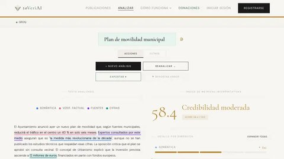
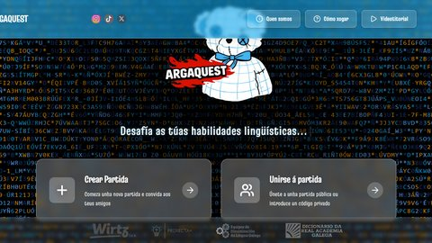
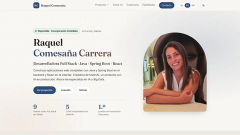

# Raquel Comesaña Carrera

**Desarrolladora Full Stack · Java · Spring Boot · React** 
A Coruña, Galicia

[Portfolio](https://raquelccarreraa.github.io/Porfolio-raquelcarrera/) · [LinkedIn](https://www.linkedin.com/in/raquel-comesa%C3%B1a-carrera-1646ba195)

---

Construyo aplicaciones web completas con **Java y Spring Boot** en el backend y **React** en la interfaz. También programo en **RPG** sobre IBM i e integro **LLMs** en productos reales. Llevo proyectos de la idea a producción y ahora me especializo en **IA y Big Data**.

- **toVeriAI**: mi producto con IA, en producción. API en Spring Boot con Spring Security y JWT, frontend en React, cinco LLMs orquestados y un modelo propio, VeriAI.
- **Seidor**: full stack en la migración de un sistema legacy IBM i, de la pantalla verde a React, con servicios REST, Spring Security y avisos automáticos con n8n.
- **ArgaQuest**: Project Manager y frontend del juego educativo que ganó el primer premio de Innovación Educativa de la Xunta de Galicia.

### Proyectos

<table>
  <tr>
    <td width="33%" valign="top">
       
      <a href="https://www.toveriai.com"><strong>toVeriAI</strong></a> 
      Índice de credibilidad de noticias con IA, de 0 a 100 y explicado. Java · Spring Boot · React · LLMs
    </td>
    <td width="33%" valign="top">
       
      <a href="https://argaquest.fernandowirtz.com/"><strong>ArgaQuest</strong></a> 
      Juego educativo en gallego. Primer premio de Innovación Educativa de la Xunta. React · Spring Boot · WebSockets
    </td>
    <td width="33%" valign="top">
       
      <a href="https://raquelccarreraa.github.io/Porfolio-raquelcarrera/"><strong>Portfolio</strong></a> 
      Mi web personal, en tres idiomas. HTML · CSS · JavaScript
    </td>
  </tr>
</table>

### Tecnologías

<picture>
  <source media="(prefers-color-scheme: dark)" srcset="https://skillicons.dev/icons?i=java,spring,react,js,mysql,python,docker,git&theme=dark">
  
</picture>

También: Spring Security · JWT · JPA/Hibernate · JUnit · Mockito · DB2 · RPG FREE · n8n · Ollama · Scrum

### Contacto

¿Tienes un proyecto o una oferta entre manos? Escríbeme: respondo rápido y con ganas.

📫 **[raquel.ccarrera@gmail.com](mailto:raquel.ccarrera@gmail.com)** &nbsp;·&nbsp; 💼 [LinkedIn](https://www.linkedin.com/in/raquel-comesa%C3%B1a-carrera-1646ba195) &nbsp;·&nbsp; 🌐 [Portfolio](https://raquelccarreraa.github.io/Porfolio-raquelcarrera/)
