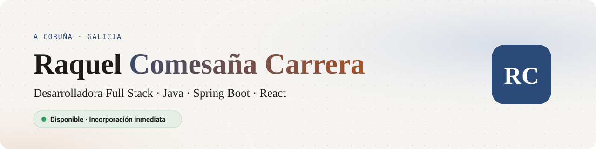

<picture>
  <source media="(prefers-color-scheme: dark)" srcset="banner-oscuro.svg">
  
</picture>

  
  
  
  

### Sobre mí

Desarrolladora full stack con foco en **Java y Spring Boot** en el backend y **React** en la interfaz. Llevo productos de la idea a producción y ahora me especializo en **IA y Big Data**.

- **toVeriAI**: mi producto con IA, en producción. API en Spring Boot con Spring Security y JWT, frontend en React, cinco LLMs orquestados y un modelo propio, VeriAI. [Ver proyecto →](https://raquelccarreraa.github.io/ToVeriAI/index.html)
- **Seidor**: full stack en la modernización de aplicaciones IBM i, de la pantalla verde a React, con servicios REST, Spring Security y avisos automáticos con n8n.
- **ArgaQuest**: Project Manager y frontend del juego educativo que ganó el primer premio de Innovación Educativa de la Xunta de Galicia.
- **Ahora**: especialización en Inteligencia Artificial y Big Data, en curso.

### Tecnologías

<picture>
  <source media="(prefers-color-scheme: dark)" srcset="https://skillicons.dev/icons?i=java,spring,react,js,mysql,python,docker,git,github,vite,postman,vercel&theme=dark&perline=12">
  
</picture>

También: Spring Security · JWT · JPA/Hibernate · JUnit · Mockito · DB2 · RPG FREE · n8n · Ollama · Scrum

### Proyectos

- [**toVeriAI**](https://raquelccarreraa.github.io/ToVeriAI/index.html): índice de credibilidad de noticias con IA, de 0 a 100 y explicado. Java · Spring Boot · React · LLMs
- [**ArgaQuest**](https://argaquest.fernandowirtz.com/): juego educativo en gallego, primer premio de Innovación Educativa de la Xunta. React · Spring Boot · WebSockets
- [**Portfolio**](https://github.com/raquelccarreraA/Porfolio-raquelcarrera): mi web personal, hecha a mano con HTML, CSS y JavaScript, en tres idiomas.

¿Tienes una oferta? Escríbeme a <a href="mailto:raquel.ccarrera@gmail.com">raquel.ccarrera@gmail.com</a>, por <a href="https://www.linkedin.com/in/raquel-comesa%C3%B1a-carrera-1646ba195">LinkedIn</a> o desde mi <a href="https://raquelccarreraa.github.io/Porfolio-raquelcarrera/">portfolio</a>.
